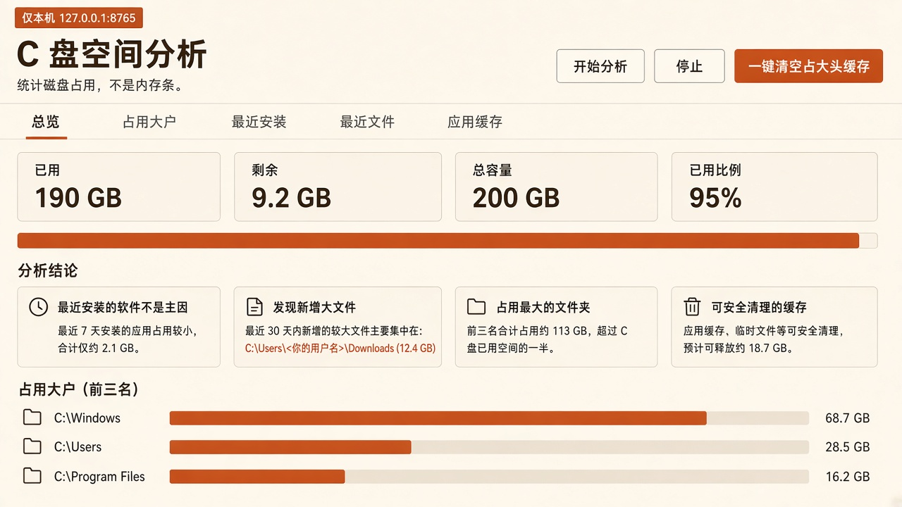
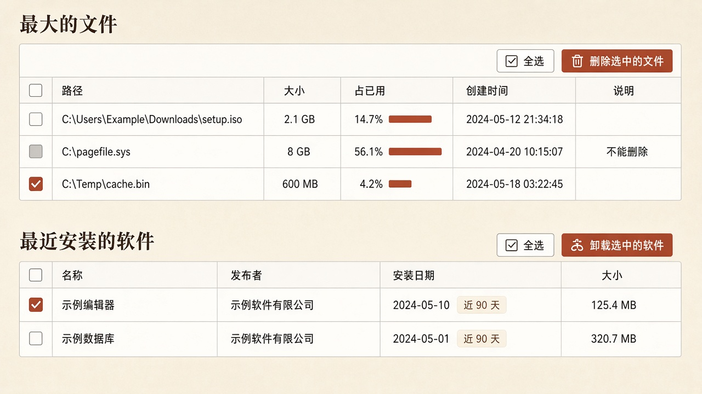
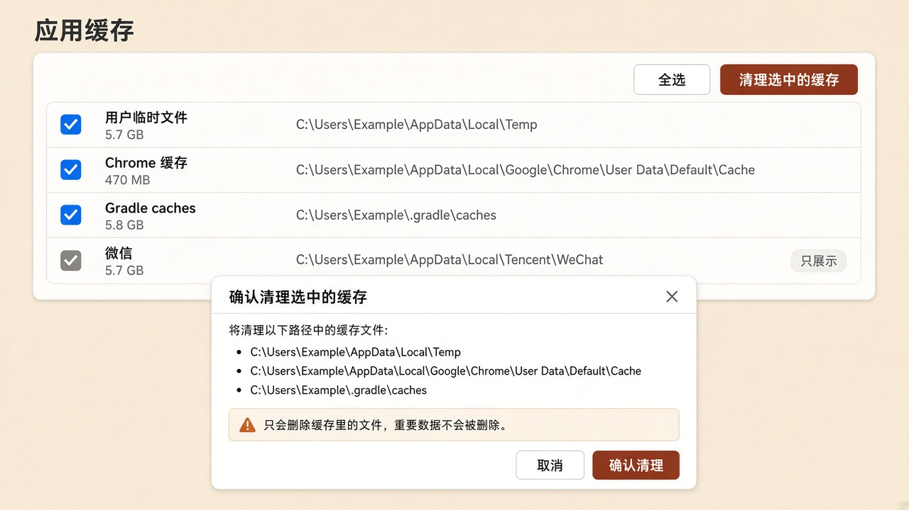
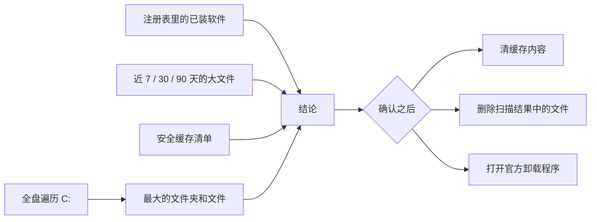

# C 盘空间分析

本机网页，用来回答一件事：**C 盘为什么满了。** 它统计的是磁盘占用，不是内存条。

打开 http://127.0.0.1:8765 就能看总览、占用大户、最近安装的软件、最近新增的大文件，以及可以安全清理的应用缓存。服务只监听 `127.0.0.1`，不对外网开放。

下面的界面图是示意，数字和路径都是例子，不是某台电脑的真实扫描结果。

## 总览

先看盘用了多少、剩多少，再看结论：最近装的软件是不是主因，新增大文件有多少，哪些一级目录真正占着空间。



已用达到 90% 时，页面会标出剩余空间。`pagefile.sys`、`hiberfil.sys`、`swapfile.sys` 只展示，不能在这里删除。

## 文件和软件

最大的文件、最近新增的文件可以勾选后删除。最近安装的软件可以勾选后卸载。每张表都有表头勾选和「全选」；当前筛选结果里能操作的行会被选中，再点一次变成「取消全选」。



删除和卸载都会先弹出确认名单：

- **删除文件**只接受本次扫描结果里出现过的路径。目录、重解析点、`C:\Windows` 以及页面文件不会删。程序目录里的文件会额外提示：删了之后对应软件可能打不开。
- **卸载软件**会按名称和安装位置，从本机卸载注册表取出官方 `UninstallString`，再打开厂商自己的卸载窗口。不会追加 `/quiet`、`/S` 这类静默参数。一次最多打开 20 个。卸载窗口里取消了也没关系，列表要等重新分析才会变。

最近新增的大文件按 7 天、30 天、90 天查看，默认只收集体积超过 50 MB 的文件。

## 应用缓存

缓存表同样可以全选，也可以只清勾中的项。页顶还有「一键清空占大头缓存」，默认指向体积靠前、且标记为可安全清理的项。



确认框会列出路径和预计释放的空间。清理只删目录里的内容，缓存文件夹本身留着；正在被占用的文件会跳过。

可以一键清理的包括用户临时目录、部分浏览器缓存、Cursor 缓存子目录、Gradle caches、npm / pip / uv 缓存等。下面这些只展示体积，**不会**被一键清掉：

- 微信、QQ、腾讯相关的用户数据
- 下载目录、文档、桌面
- Maven 仓库、Windows 更新下载、Package Cache
- 休眠文件和页面文件

## 它怎么判断



- 软件来自 `HKLM`、`WOW6432Node` 和 `HKCU` 的卸载项。系统组件和更新补丁会跳过。近 90 天视为最近安装；只对明确的安装目录测量体积，不会去扫 `C:\`、`C:\Windows` 或 Program Files 根目录。
- 全盘遍历不跟随联接点和符号链接。没权限的目录记一笔然后跳过。
- 扫描分两段：先出软件、缓存和最近安装目录的体积，再走完整的 C 盘。快速测量还没结束时不能清缓存，全盘扫描进行中可以先清。

## 运行

需要 Windows 和 Python 3.10 及以上。虚拟环境和扫描结果都放在项目目录里，避免再去挤 C 盘。

```bat
cd /d D:\c-disk-analyzer
python -m venv .venv
.venv\Scripts\python.exe -m pip install -r requirements.txt
.venv\Scripts\python.exe run.py
```

也可以直接双击 `启动.bat`。虚拟环境已经建好时，它会打开 http://127.0.0.1:8765 。

扫描结果写在本机的 `data/last_scan.json`，这个文件不进仓库。上次如果扫到一半，再次打开会先显示已保存的部分，不会自动重头扫。

## 目录

| 路径 | 作用 |
| --- | --- |
| `run.py` / `启动.bat` | 启动入口，绑定 127.0.0.1:8765 |
| `app/scanner.py` | 遍历 C 盘，统计大目录和大文件 |
| `app/software.py` | 读取卸载注册表，测量安装目录 |
| `app/caches.py` | 安全缓存清单和清理 |
| `app/actions.py` | 删除已扫描文件、启动官方卸载程序 |
| `static/` | 中文网页 |
| `tests/` | 路径安全和删除边界测试 |

```bat
.venv\Scripts\python.exe -m unittest tests.test_cache_safety tests.test_file_actions
```

## 边界

网页上的按钮不能绕过服务端校验。不在本次扫描列表里的路径、Windows 目录、页面文件，以及清单之外的缓存，请求都会被拒绝。卸载命令由服务端查注册表，不接受浏览器传来的任意命令。
